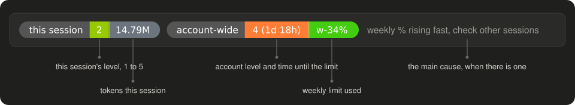

# my-mods

Personal Claude Code mods, published as a plugin marketplace so every machine installs the same versions.

| Mod | What it adds |
|---|---|
| [token-band](token-band/README.md) | Two pills above the prompt showing how hard this session and the whole account are using the weekly limit, with token counts for each |
| [task-board](task-board/README.md) | A desktop side pane board of what Claude is doing, what is queued and what is done |



## Install on a machine

The repo is private, so the machine needs git access to it. With the personal SSH key under the `github-personal` host alias:

```bash
claude plugin marketplace add git@github-personal:earthjan/my-mods.git
```

```bash
claude plugin install token-band@my-mods && claude plugin install task-board@my-mods
```

Then run `/reload-plugins` in an open session.

To pick up new versions automatically, add `"autoUpdate": true` to the `my-mods` entry under `extraKnownMarketplaces` in `~/.claude/settings.json`. Claude Code then refreshes the mods when it starts.

## Releasing a change

1. Edit the mod and run its tests with `claude plugin test <mod>`.
2. Bump `version` in that mod's `.claude-plugin/plugin.json`. Without a bump, machines see nothing new.
3. Commit and push to `main`.
