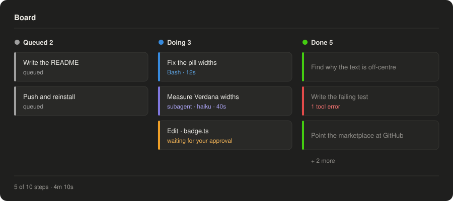
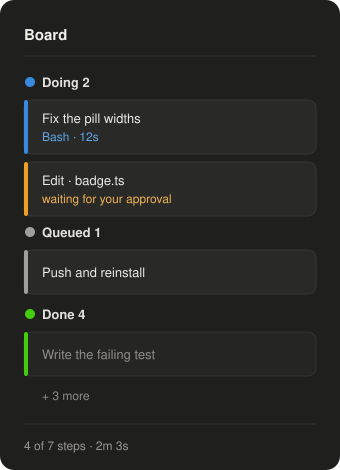
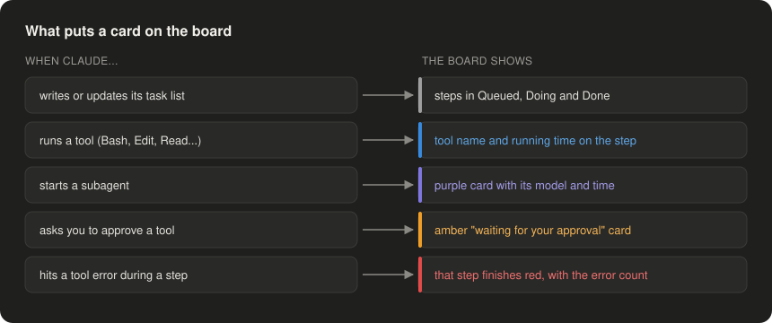

# task-board

A side pane in the Claude Code desktop app that shows what Claude is doing right now, what is queued next, and what is done, as a live board you can read at a glance.



## Reading the board

**Each card is one step of Claude's plan**, and the coloured bar on its left says what state it is in. Colour only ever sits on that bar, the column dot and the status line, so the text keeps full contrast.

| Bar | Meaning |
|---|---|
| Grey | queued, not started yet |
| Blue | in progress, with the tool running now and for how long |
| Purple | a subagent Claude started, with its model |
| Amber | waiting for you to approve a tool |
| Red | finished, but tool errors happened during it |
| Green | done |

The footer shows how many steps are done and how long the plan has been running.

## Wide and narrow

**At 70 columns or wider the board shows three columns**, Queued, Doing and Done, and keeps the three most recent finished steps. **In a narrower pane it stacks into one column** with Doing on top, keeps only the latest finished step, and folds the rest into "+ n more".



## Where the cards come from

The board reads Claude's own activity in this session; there is nothing to set up.



It understands the desktop app's task list (`update_plan` and `wrap_up`) and Claude Code's todo list (`TodoWrite`).

## Install

From the `my-mods` marketplace (see the [repo README](../README.md)):

```bash
claude plugin install task-board@my-mods
```

Then run `/reload-plugins`. In the desktop app the board opens by itself when a session starts; `/board` opens it again after you close it, and works in the terminal too.

## Limits worth knowing

- Running times update whenever the board redraws, which is every time a tool starts or ends, not every second.
- An amber "waiting" card stays until that tool call finishes, since there is no event for the moment you approve.
- The board shows only the session it is open in.
- Claude Code's `TaskCreate` and `TaskUpdate` tools are not read yet.

## Development

```bash
claude plugin test .
claude plugin validate .
```

`hooks/register.tsx` wires the events and the pane. `plan.ts` and `runs.ts` turn tool calls into board state, `lanes.ts` turns that state into cards, and `view.tsx` draws them.
