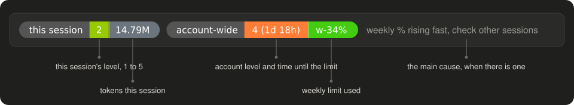
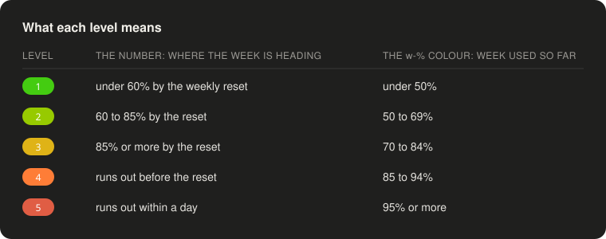
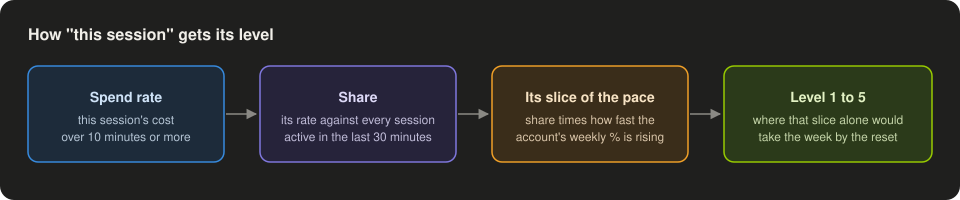

# token-band

A row of two pills above the Claude Code prompt that tells you, at a glance, how hard you are using your weekly limit: this session on the left (`session`), your whole account on the right (`account`), and the main reason when usage is climbing.



## Reading the band

**The left pill is this session.** Its number is a level from 1 (relaxed) to 5 (you will hit the limit within a day) for this session's own share of your usage, and the grey segment is how many tokens the session has used, subagents included.

**The right pill is your whole account.** Its number is the same 1 to 5 scale for every session together, followed by the time left before you hit the weekly limit (`4 · 1d 18h`) when the current pace would get there. The grey segment is how many tokens every session on this machine has used since the weekly limit last reset; usage on other machines or on claude.ai is not in it. The last segment, `w-34%`, is how much of this week's limit is already used, coloured by how close that is to full.

**The grey note names the main cause**, when there is one: a cache miss that re-wrote a big prompt, a conversation so large it is re-read every turn, several subagents in one turn, the Fable model, very long output, or the weekly % rising fast because of other sessions.



**The little bonsai after the pills grows with you.** It counts every finished turn on this machine, across all sessions, and grows from a sprout to a sapling at 100 turns, a tree at 500 and 2,000, and comes into bloom at 10,000. Its canopy sways, petals fall once it blooms, and it sparkles for a moment whenever a turn finishes. It makes the band two rows tall, and surfaces that cannot run an animated part (VS Code, mobile) leave it out.

## How the session level is worked out

Claude Code reports usage for the whole account, not per session, so the left pill is an estimate. Each session records how fast it is spending, compares that with every other session active in the last 30 minutes, and takes its share of the account's pace.



That is why a fresh session reads **measuring** for its first 10 minutes, and **no estimate** before the account has a weekly reading.

## Install

From the `my-mods` marketplace (see the [repo README](../README.md)):

```bash
claude plugin install token-band@my-mods
```

Then run `/reload-plugins` in an open session. The band appears above the prompt in the terminal and in the desktop app.

## Limits worth knowing

- The session level is an estimate built from spend rates, so two busy sessions started at the same moment can briefly disagree.
- The account pace needs 10 minutes of readings before it can project anything; until then the level falls back to how much of the week is used.
- Session readings older than a day are forgotten.
- The bonsai's turn count lives on this machine only; a new machine starts from a sprout.

## Development

```bash
claude plugin test .
claude plugin validate .
```

`hooks/register.tsx` wires the events and the band; everything else in `hooks/` is plain functions that the tests cover. Pill widths come from measured Verdana 11px character widths in `hooks/badge.ts`, so text stays centred in each segment.
